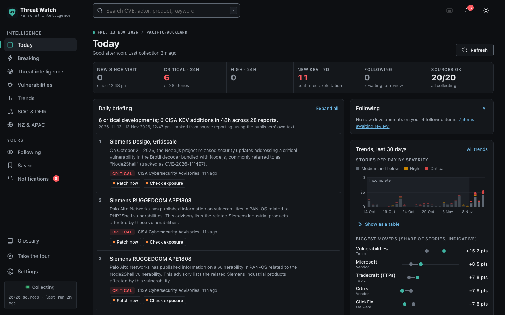
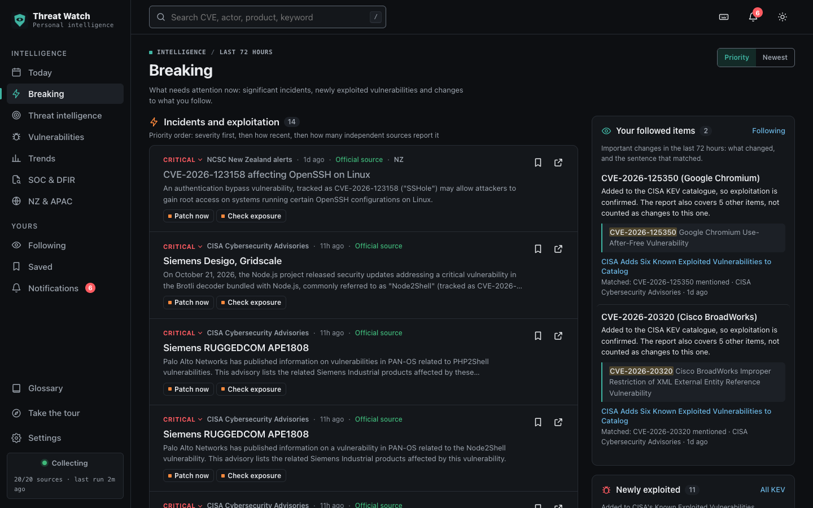
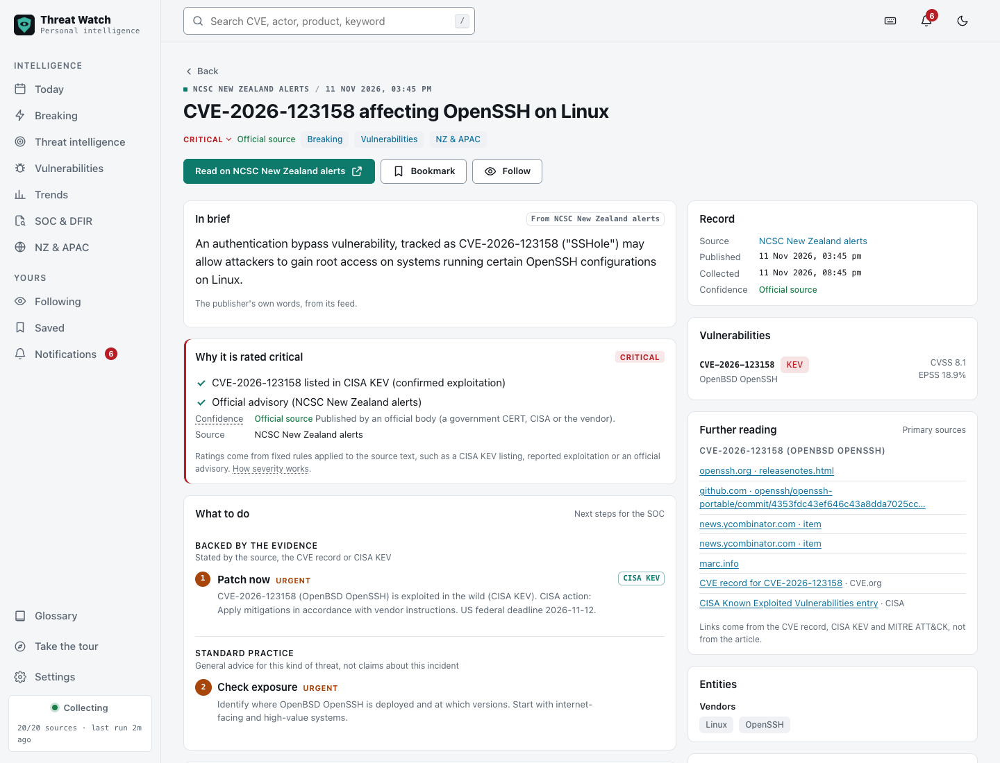
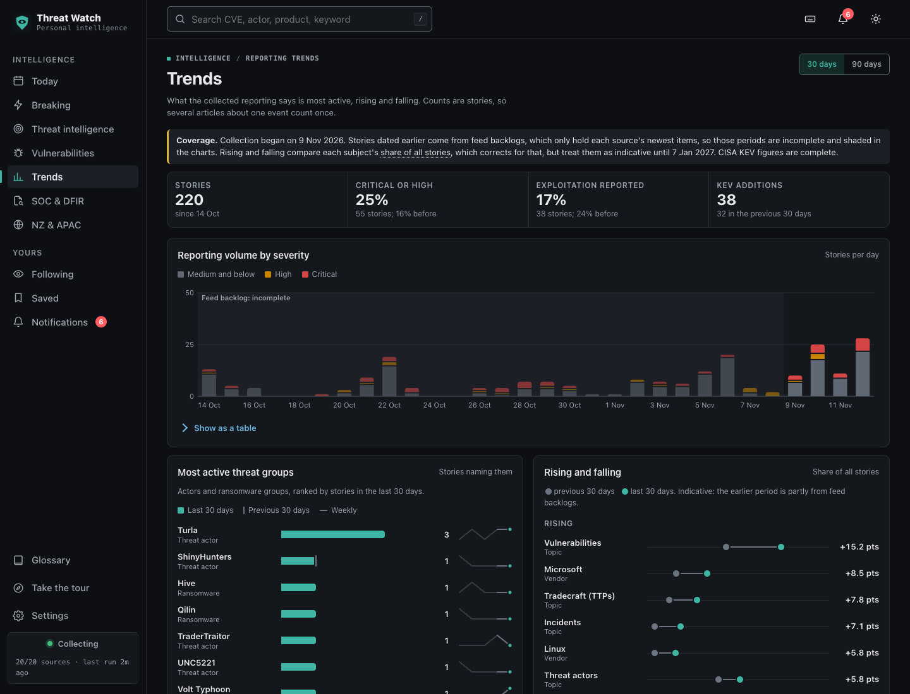
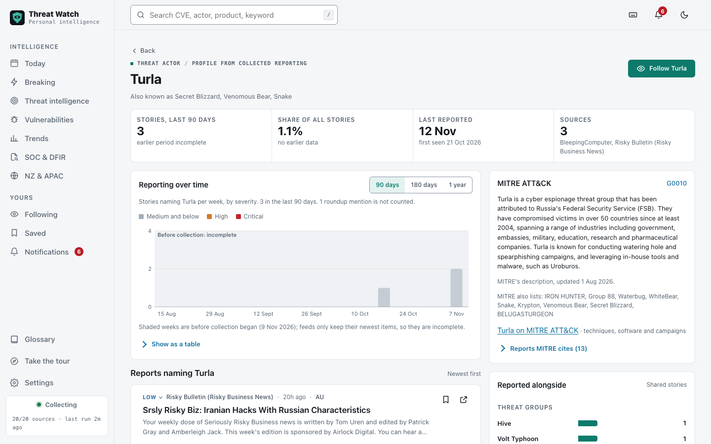
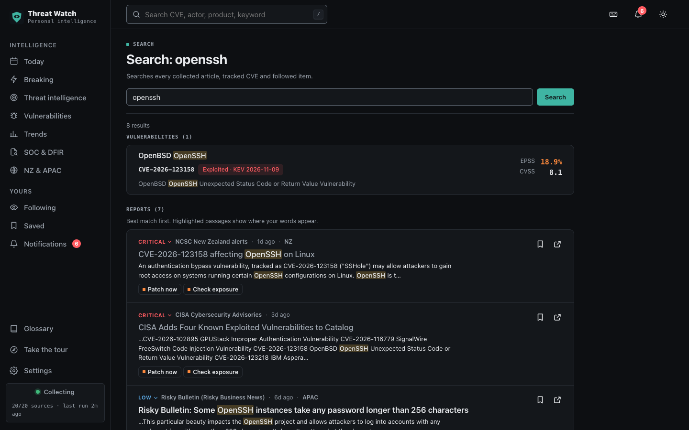
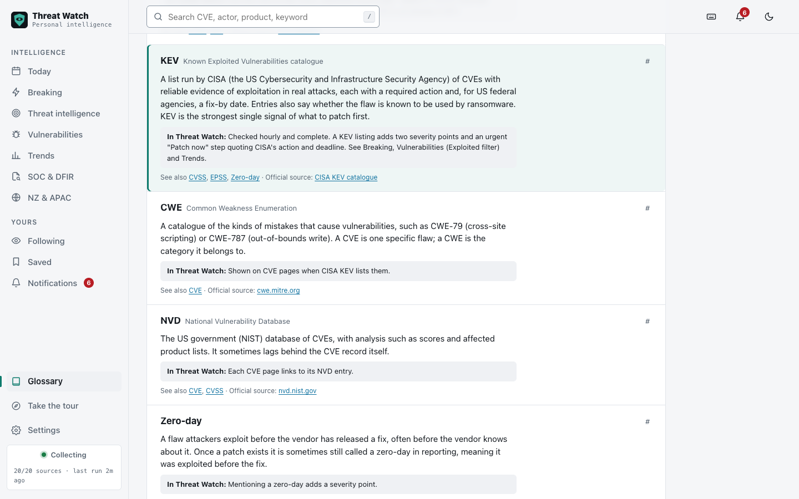
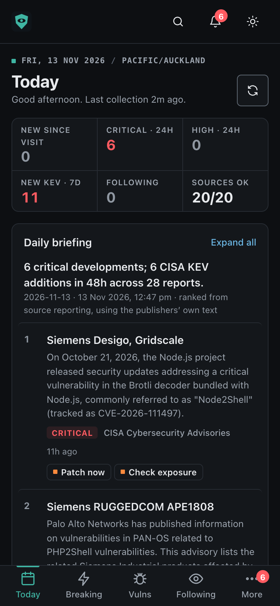
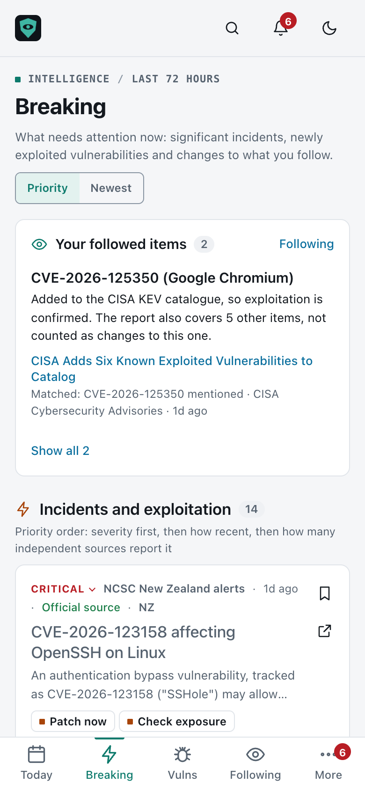
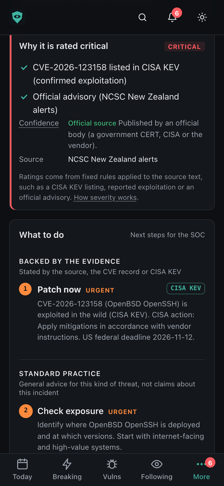

# Threat Watch

A private, single-user cybersecurity intelligence platform. It collects real reporting from trusted
security sources every two hours, rates each story with stated reasons, writes a daily briefing,
and lets you **follow** evolving threats: new reporting is matched to a persistent, versioned,
source-cited record, and you are told what actually changed.

Works in a desktop browser and as an installable app (PWA) on Android, with push notifications.



| | |
|---|---|
| Backend | Python 3.13 · FastAPI · SQLite (WAL + FTS5) · APScheduler worker |
| Frontend | React 19 · TypeScript · Vite · PWA (Workbox service worker), no chart or UI libraries |
| AI (optional) | Anthropic API (default `claude-opus-5-5`), cached, budgeted, citation-validated; everything works without it |
| Deployment | Docker Compose (two small containers, about 100 MB of memory), private access via Tailscale Serve |

## Screenshots

<table>
<tr>
<td width="50%"><br><b>Breaking.</b> Incidents first, with changes to what you follow and newly exploited CVEs alongside.</td>
<td width="50%"><br><b>Article.</b> Why it got its rating, evidence-backed steps vs standard practice, and primary sources.</td>
</tr>
<tr>
<td><br><b>Trends.</b> Volume by severity, most active groups, and what is rising or falling by share of stories.</td>
<td><br><b>Threat group profile.</b> Weekly reporting, related subjects and the group's MITRE ATT&CK entry.</td>
</tr>
<tr>
<td><br><b>Search.</b> Full-text search with the matching passage highlighted.</td>
<td><br><b>Glossary.</b> KEV, EPSS, CVSS and every label in the app, explained.</td>
</tr>
</table>

<p>



</p>

The screenshots show real public reporting collected by the app; no personal data.

## What it does

- **Today:** the 07:00 (Pacific/Auckland) daily briefing, what is new since your last visit, followed-item updates, new CISA KEV entries and a 30-day trends panel.
- **Breaking:** significant incidents and exploitation from the last 72 hours, with a priority/newest toggle that explains its ordering.
- **Topic feeds:** Threat intelligence, SOC & DFIR, and NZ & APAC, filterable by topic, severity and date.
- **Vulnerabilities:** every tracked CVE with CISA KEV status, FIRST EPSS and CVSS, affected products and references.
- **Ransomware:** which groups post the most leak-site claims, against which sectors and countries, what is rising and falling, and claims against New Zealand and Australian organisations. Claims come from ransomware.live, are labelled as unverified, and link to Threat Watch reporting when a story names the victim.
- **Trends and threat group profiles:** charts of what the reporting says is active, rising and falling; each actor, ransomware group and malware family has a profile linked to MITRE ATT&CK.
- **Following:** incidents, CVEs, actors, malware or topics. Reports are matched automatically, the sentence that matched is shown, broad bulletins never count as changes, and partial matches wait for your review.
- **What to do:** next steps for a SOC on each story, split into steps backed by the evidence (source, CVE record, CISA KEV) and general playbook advice.
- **Further reading:** vendor advisories, CVE records, KEV entries and ATT&CK pages, taken only from stored data.
- **Search, Saved, Notifications, Glossary**, keyboard shortcuts (`?`), a guided tour, and light and dark themes.

**Bookmark** saves one article. **Follow** keeps tracking an evolving subject.

## Quick start (local development)

```bash
python3.13 -m venv .venv && .venv/bin/pip install -r backend/requirements-dev.txt
cd backend
export TW_DATA_DIR=../.localdata TW_COOKIE_SECURE=false
../.venv/bin/python -m app.cli set-password analyst     # interactive; min 12 chars
../.venv/bin/python -m app.cli ingest --force           # first collection (about 1 to 2 min)
../.venv/bin/uvicorn app.main:create_app --factory --port 8000 &
../.venv/bin/python -m app.worker &                     # scheduler (optional locally)
cd ../frontend && npm ci && npm run dev                 # http://localhost:5173 (proxies /api)
```

Tests: `cd backend && ../.venv/bin/python -m pytest -q` · Frontend type-check and build: `cd frontend && npm run build`

Run the whole stack locally in Docker with `deploy/local.sh up` (http://localhost:8787), then `deploy/local.sh password` once.

## Deploying

See [docs/DEPLOYMENT.md](docs/DEPLOYMENT.md). In short: a small Linux VM (1 GB is enough), images built on your
machine and shipped with `deploy/deploy.sh <ssh-host>`, private HTTPS through Tailscale Serve, the app bound
to localhost only, a firewall allowing just SSH and Tailscale, nightly backups on the server, and a daily
copy to your Mac. Secrets live in `/etc/threatwatch/threatwatch.env` on the server, never in git.

## Documentation

- [Architecture](docs/ARCHITECTURE.md): components, data model, matching and assessment rules, AI safeguards
- [Design](docs/DESIGN.md): design system, tokens, components, chart rules and the redesign log
- [Deployment](docs/DEPLOYMENT.md): server setup, deploy, updates, backup and restore
- [Security](docs/SECURITY.md): threat model, controls, external data and links
- [Implementation status](docs/STATUS.md): what is done and what is not
- [Decisions](docs/DECISIONS.md): consequential product and architecture decisions
- [Configuration example](deploy/threatwatch.example.env)

## Data integrity rules

- Articles are never fabricated: every item comes from a source adapter and keeps its original URL, publication and retrieval times.
- Evidence (articles, KEV, EPSS and CVE data, MITRE ATT&CK) is stored separately from model output (`ai_outputs`, briefings, watch summaries).
- Generated claims must cite supplied evidence IDs; uncited claims are dropped. IOCs are only ever extracted deterministically from source text.
- Counts and charts say what they measure (stories, not attacks) and mark incomplete periods.
- Test fixtures (`backend/tests/fixtures`) are synthetic, use `example.*` hosts and `CVE-2099-*` IDs, and never enter a production database.
